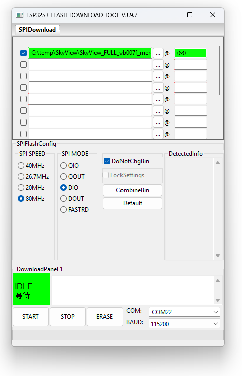

# Flashing the T-Display AMOLED Board for the First Time

Starting with **VB007f**, SkyView is flashed as **one single file** at address `0x0`.
The full image contains everything the board needs: bootloader, partition table, firmware, settings storage (SPIFFS) and the voice alert audio files.

> **Upgrading from VB007e or older?** VB007f uses a new partition layout (see below). You must do this USB flash once.
> An OTA / WebFlash update alone will **not** create the new audio partition, and voice alerts will not work from flash.

## What you need

| File | Where to get it | Flash address |
|---|---|---|
| `SkyView_FULL_vb007f_merged.bin` | [Latest release](https://github.com/slash-bit/SkyView-AMOLED-round-1.75-TFT_eSPI/releases) or the `binaries` folder | `0x0` |

You do **not** need `bootloader.bin`, `partitions.bin`, `boot_app0.bin`, `spiffs.bin` or `audio_littlefs.bin`. They are all already inside the full image.

## Option A: ESP32 Flash Download Tool (Windows)

1. **Download the firmware**:
    - Download `SkyView_FULL_vb007f_merged.bin` and save it in a folder on your PC, e.g. `C:\temp\SkyView`.

2. **Download the ESP32 Flashing Tool**:
    - Visit the [Espressif website](https://docs.espressif.com/projects/esp-test-tools/en/latest/esp32/production_stage/tools/flash_download_tool.html) to download the ESP32 Flashing Tool.

3. **Set up the Flashing Tool**:
    - When starting the tool, choose chip type `ESP32-S3`, work mode `Develop` and load mode `UART`.
    - In the file list, tick **only one row**: select `SkyView_FULL_vb007f_merged.bin` and enter the address `0x0`.
    - Untick any other rows left over from earlier versions (bootloader, partitions, boot_app0, firmware, spiffs).
    - Tick **DoNotChgBin** so the tool keeps the flash settings stored in the image. If your tool version has no such option, set **SPI SPEED** `80MHz`, **SPI MODE** `DIO` and **FLASH SIZE** `16MB` (these match the image).



4. **Select the COM Port**:
    - Connect the AMOLED board to your PC with a USB-C data cable.
    - In the `COM:` dropdown list, select the COM port of the board.
    - If no COM port appears, hold the **BOOT** button, press and release **RESET**, then release **BOOT** to put the board into download mode.

5. **Erase the Board**:
    - Click the **Erase** button and wait until it says "Finished" (this takes a few seconds).
    - Erasing clears all saved settings and the buddy list. Back up your buddy list first if you need it.

6. **Flash the Firmware**:
    - Click the **Start** button. The image is 16MB, so flashing takes about 1 to 3 minutes.
    - Wait until it says "Finished".

7. **Power Cycle the Board**:
    - Press the reset button.

The SkyView software is now installed.

## Option B: esptool (Windows / macOS / Linux)

```
esptool.py --chip esp32s3 --baud 921600 erase_flash
esptool.py --chip esp32s3 --baud 921600 write_flash 0x0 SkyView_FULL_vb007f_merged.bin
```

If the transfer fails, lower `--baud` to `460800`.

## Partition layout (VB007f and later)

| Name | Type | Offset | Size | Contents |
|---|---|---|---|---|
| nvs | data / nvs | `0x9000` | 20 KB | System settings |
| otadata | data / ota | `0xE000` | 8 KB | OTA boot selection |
| app0 | app / ota_0 | `0x10000` | 2.75 MB | Firmware (slot 1) |
| app1 | app / ota_1 | `0x2D0000` | 2.75 MB | Firmware (slot 2, used by OTA) |
| spiffs | data / spiffs | `0x590000` | 448 KB | Settings, buddy list, PureTrack DB, demo NMEA |
| audio | data / LittleFS | `0x600000` | ~10 MB | Voice alert files `/Audio/voice1..3` |
| coredump | data / coredump | `0xFF0000` | 64 KB | Crash dump |

Because the voice files are now stored in internal flash, **an SD card is no longer required** for voice alerts. If the audio partition is empty, SkyView will still use voice files from an SD card when one is inserted.

## Later firmware updates

Once the board is running VB007f or later, you can update the firmware without a USB cable:

- Open the SkyView web page, go to the **Firmware** tab and upload the app-only file (e.g. `SkyView_firmware_vb007f.bin`).
- OTA updates keep your settings, buddy list and voice files.
- Do **not** upload the `FULL_..._merged.bin` image via OTA. It is only for USB flashing at `0x0`.

## Replacing or restoring voice files

The voice files can be managed from the web interface on the **Files** tab:

- **Upload folder**: select the `Audio` folder (containing `voice1`, `voice2`, `voice3`) or a single voice folder.
- **Erase flash audio**: wipes the audio partition.

Restart SkyView after uploading so it plays the new files. If the Files tab shows *"No audio partition - flash full firmware via USB"*, the board still has the old partition layout. Repeat the USB flash above.
